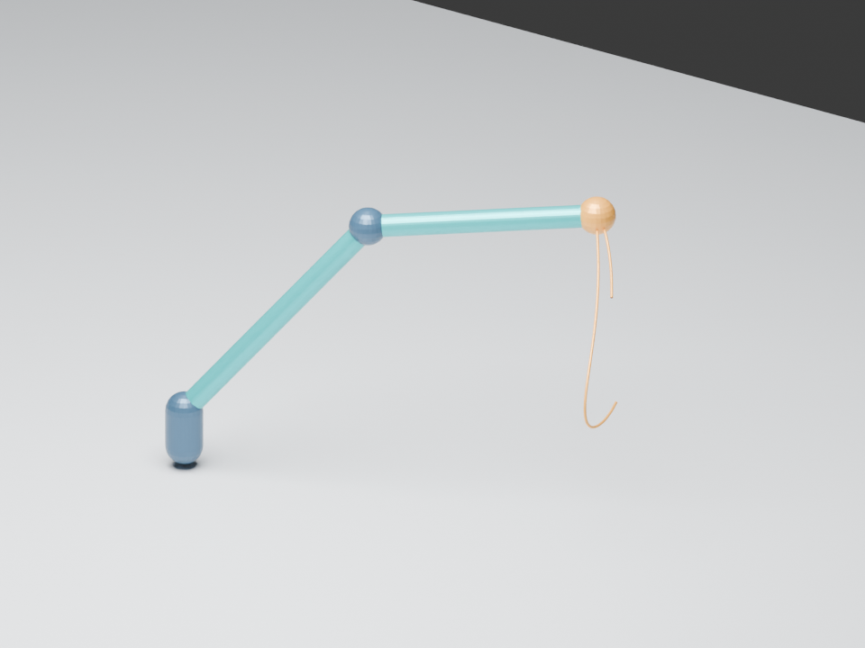

# Figures and provenance

`robot-preview.png` es una vista propia de Blender 5.1.2 generada con `scripts/build_blender_scene.py` a partir de `experiments/exp-001-differential/results/run-001/motion.json`. El [manifiesto](blender-manifest.json) registra hashes de entrada y script.

La representación usa cilindros y articulaciones esquemáticas con longitudes del paper. No es una fotografía, plano del fabricante, réplica CAD fiel ni validación física. El archivo `.blend` animado está en `outputs/blender/` y es regenerable.
