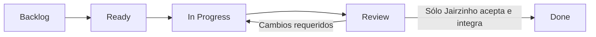

# Operating model

Una issue define objetivo, responsable del equipo, dependencias, evidencia y criterios para Review. Los estados no son porcentajes de avance. Una tarea bloqueada describe el bloqueo y próxima acción sin considerarse terminada.

El repositorio usa ramas de tarea y PR hacia `develop`. La promoción a `main` requiere una decisión independiente de Jairzinho. El bootstrap inicial contiene sólo identificación y reglas; no afirma aprobación académica. No se usa `Closes`, `Fixes` ni otras palabras que cierren automáticamente issues; usar `Refs #N`.

El agente no fusiona, no habilita auto-merge, no cierra issues como completadas, no asigna Completed date ni mueve tarjetas a Done. Se desactivaron las seis automatizaciones que GitHub habilitó por defecto al crear el tablero, incluidas Auto-close issue, Item closed y Pull request merged. No se activan horarios ni agentes persistentes.

## Evidencia mínima por trabajo

- Pregunta o problema, referencia y supuestos.
- Cambio acotado y criterio de comprobación.
- Comando reproducible, configuración y resultado, incluidos fallos relevantes.
- Diferencia entre verificación matemática, validación física y decisión humana.

## Herramientas documentales

Markdown para estudiar e iterar; Mermaid para relaciones simples; PNG/SVG para figuras científicas; notebooks para explorar; Blender para escenas. LaTeX se reserva para el informe; PPT se produce cuando un guion o una exposición lo requiera. No se multiplican documentos para repetir el mismo contenido.
