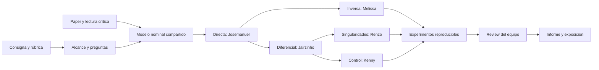
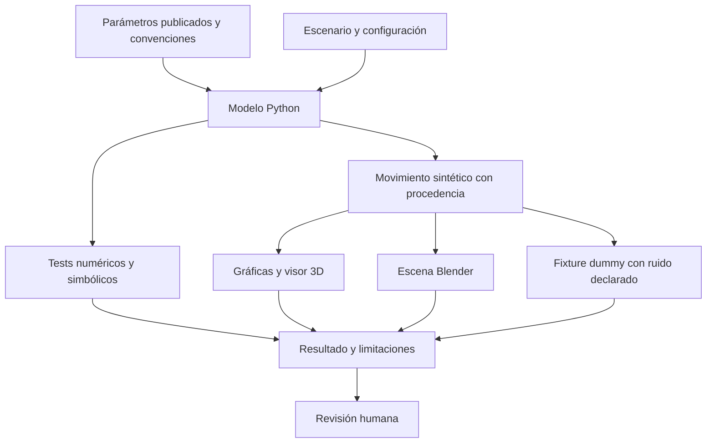

# Study map

El estudio conecta la lectura con una pregunta, una prueba y una decisión. Los productos académicos se construyen desde evidencia revisada.

## Flujo de evidencia

El movimiento sintético, el sensor dummy y las mediciones reales son categorías diferentes. Un resultado visualmente correcto puede seguir teniendo un modelo equivocado; por eso las pruebas se conservan junto a las figuras.
