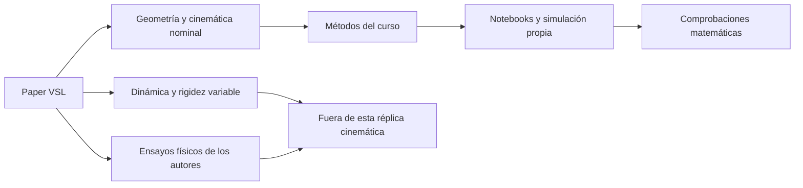
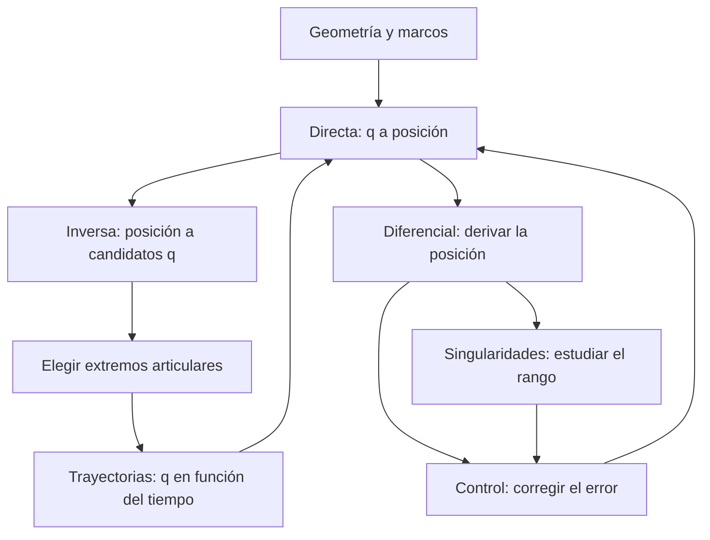

# Study guide · comprender y replicar el modelo

Esta guía explica el paper y el desarrollo del parcial desde sus fundamentos. Cada tema reúne un README conceptual y un notebook de Python con ecuaciones, código sencillo, gráficas y comprobaciones. Los notebooks tienen salidas guardadas y se pueden leer en GitHub sin instalar herramientas.

## Qué estudia el paper

Ramzy, Hammad y Maged (2024) presentan un manipulador de tres grados de libertad con eslabones de rigidez variable, o **VSL** (*Variable Stiffness Links*). Su estudio incluye cinemática, dinámica y validación experimental. La rigidez describe cuánto se deforma un elemento ante una carga; estudiar sólo posiciones y velocidades no reproduce ese comportamiento.

La réplica del parcial utiliza la **geometría rígida nominal**: tres articulaciones rotacionales, dimensiones publicadas y relaciones cinemáticas reconstruidas. A partir de esa base se desarrollan los métodos enseñados en clase. Los controladores y trayectorias de los notebooks son ensayos propios adaptados al robot; no se presentan como una reproducción de todos los experimentos del artículo.

| Evidencia del artículo | Uso en este estudio | Qué permite afirmar |
|---|---|---|
| Tabla 1, p. 4: parámetros DH | Definir marcos y transformaciones | Estructura de la cadena nominal |
| Ecs. 6–8, p. 5: posición | Construir y contrastar la directa | Relación entre ángulos y posición |
| Tabla 2, p. 9: longitudes | Usar 0.04, 0.29 y 0.24 m | Dimensiones nominales publicadas |
| Tabla 3, p. 14: posiciones de los autores | Contraste documental abierto | Hay diferencias que requieren explicación |
| Dinámica y ensayos físicos | Contexto del artículo | No han sido reproducidos por estos notebooks |

[Lectura documental e incidencias](../docs/paper.md) · [Artículo original](https://doi.org/10.3390/app14125285) · [Correspondencia con las clases](../docs/course-alignment.md)

Las matrices impresas del paper contienen inconsistencias ya registradas. Se reconstruyen mediante DH y se verifican propiedades de rotación. En la primera fila de la tabla 3 persisten diferencias: no se ajustan dimensiones para hacer coincidir cifras. Una prueba numérica correcta demuestra consistencia interna, no resuelve por sí sola esa discrepancia.



## Bases antes de comenzar

Un **eslabón** conecta articulaciones; una **articulación rotacional** permite girar alrededor de un eje. RRR significa tres articulaciones de ese tipo. Los tres grados de libertad son tres variables independientes: base, hombro y codo. No equivalen a controlar libremente las seis componentes de una pose espacial.

Un **marco de referencia** tiene un origen y tres ejes. La **posición** localiza un punto mediante x, y, z. La **orientación** indica hacia dónde apuntan los ejes del efector. La **pose** combina ambas. Todas las posiciones y velocidades de estas guías se expresan respecto de la base fija.

Un vector es una lista ordenada de componentes. Una matriz transforma vectores: en Python, `J @ dq` combina las columnas de `J` con los pesos de `dq`. `*` multiplica entradas; no compone transformaciones. NumPy representa nuestros vectores con forma `(3,)`; se interpretan como columnas al escribir la matemática.

La trigonometría descompone longitudes: `L*cos(angle)` es proyección horizontal y `L*sin(angle)`, vertical. Python usa **radianes**: `np.deg2rad(90)` equivale a pi/2. Las derivadas de seno y coseno que se emplean aquí también presuponen radianes.

Una derivada mide sensibilidad local. Si cambia una articulación y las otras permanecen fijas, la derivada parcial indica cómo cambia cada coordenada. Un conjunto de esas derivadas forma el Jacobiano. La integración numérica realiza el recorrido contrario en el tiempo: acumula velocidades para actualizar posiciones o ángulos.

| Símbolo | Significado | Unidad / tamaño |
|---|---|---|
| $q=(q_1,q_2,q_3)^T$ | Ángulos de base, hombro y codo | rad; 3 componentes |
| $\dot q$ | Velocidades articulares | rad/s; 3 componentes |
| $p=P_{03}$ | Posición del efector | m; 3 componentes |
| $M_{03}$ | Transformación de marco 3 a base | 4×4; contiene rotación y posición |
| $J_L$ | Ángulos → cambios de posición | 3×3; m/rad |
| $J_\omega$ | Velocidades articulares → angular | 3×3; relación entre rad/s |
| $h_d$, $e$ | Posición deseada y error cartesiano | m; 3 componentes |

En las notas de geometría, `height` es altura relativa al hombro. En los ejemplos de control del curso, $h$ representa el vector de posición completo. Se explicita esta diferencia para no confundir un escalar con un vector.

## Recorrido de aprendizaje

| Orden | Tema y explicación | Notebook | Pregunta que responde |
|---|---|---|---|
| 1 | [Cinemática directa](forward-kinematics/README.md) | [Abrir](forward-kinematics/study.ipynb) | Dados los ángulos, ¿dónde queda el efector? |
| 2 | [Cinemática inversa](inverse-kinematics/README.md) | [Abrir](inverse-kinematics/study.ipynb) | Dado un punto, ¿qué ángulos pueden alcanzarlo? |
| 3 | [Cinemática diferencial](differential-kinematics/README.md) | [Abrir](differential-kinematics/study.ipynb) | ¿Cómo se convierten velocidades articulares en cartesianas? |
| 4 | [Singularidades](singularities/README.md) | [Abrir](singularities/study.ipynb) | ¿En qué posturas se pierden direcciones de movimiento? |
| 5 | [Trayectorias](trajectories/README.md) | [Abrir](trajectories/study.ipynb) | ¿Cómo se distribuye un movimiento a lo largo del tiempo? |
| 6 | [Control cinemático](control/README.md) | [Abrir](control/study.ipynb) | ¿Cómo se corrige un error de posición durante el movimiento? |
| Opcional | [Datos sintéticos](synthetic-data/README.md) | [Abrir](synthetic-data/study.ipynb) | ¿Cómo se comprueba el procesamiento con ruido conocido? |



El diagrama expresa dependencias matemáticas, no un requisito de ejecutar todos los notebooks en una misma sesión. Cada uno vuelve a definir lo que necesita, con funciones pequeñas y sin clases, archivos de datos externos ni importaciones ocultas del proyecto.

## Cómo leer cada notebook

Primero se lee la pregunta y la ecuación. Después se observa qué variables de Python representan sus símbolos. Finalmente se ejecuta o se inspecciona la salida y se explica qué comprueba el resultado. Un `assert` expresa una propiedad que debe cumplirse; si falla, la ejecución se detiene para revisar el supuesto.

Los ejemplos repiten algunas funciones de forma intencional para mantener cada notebook autocontenido. La implementación reutilizable continúa en [code/](../code/README.md). Los notebooks usan las mismas convenciones y los mismos casos principales; las rutinas de producción añaden validaciones de entrada y tratamiento más completo de casos degenerados.

| Caso existente | Notebook que lo explica |
|---|---|
| `simulations/course` | Directa, inversa, singularidades, trayectorias y control |
| `simulations/differential` | Diferencial, con la misma trayectoria prescrita y refinamiento de paso |
| `simulations/dummy-sensor` | Datos sintéticos, con la misma semilla y distribución |
| Visor HTML y Blender | Representaciones del movimiento diferencial; no son otro modelo físico |

## Uso local opcional

Para leer en GitHub basta abrir los enlaces anteriores. Los diagramas Mermaid están en los README; las ecuaciones, salidas y gráficas están también en los notebooks. Para editar y ejecutar desde la raíz del repositorio:

```sh
uv sync --locked --group study
uv run --group study jupyter lab notebooks
```

En Jupyter se abre un notebook y se utiliza **Restart Kernel and Run All Cells** para ejecutarlo desde cero. No necesita ejecutar previamente otro notebook. La ruta de estudio está en esta guía, no en el orden alfabético de carpetas.

Para comprobar todos sin modificar sus salidas:

```sh
uv run --group study python run.py notebooks
```

Para actualizar las salidas guardadas después de una edición:

```sh
uv run --group study python run.py notebooks --save
uv run python run.py test
```

La reejecución no modifica el PDF ni los resultados históricos de `simulations/`. Incorporar un cambio al informe requiere actualizar sus fuentes y recompilarlo siguiendo la [guía de reproducción](../docs/reproduce.md).

## Qué debe quedar comprendido

La directa establece la geometría; la inversa busca configuraciones compatibles; la diferencial describe velocidades locales; las singularidades delimitan lo que esas velocidades pueden lograr; las trayectorias organizan el tiempo; el control usa esas relaciones para corregir errores. Todas las conclusiones de los notebooks se limitan al modelo nominal y a los casos ensayados.
