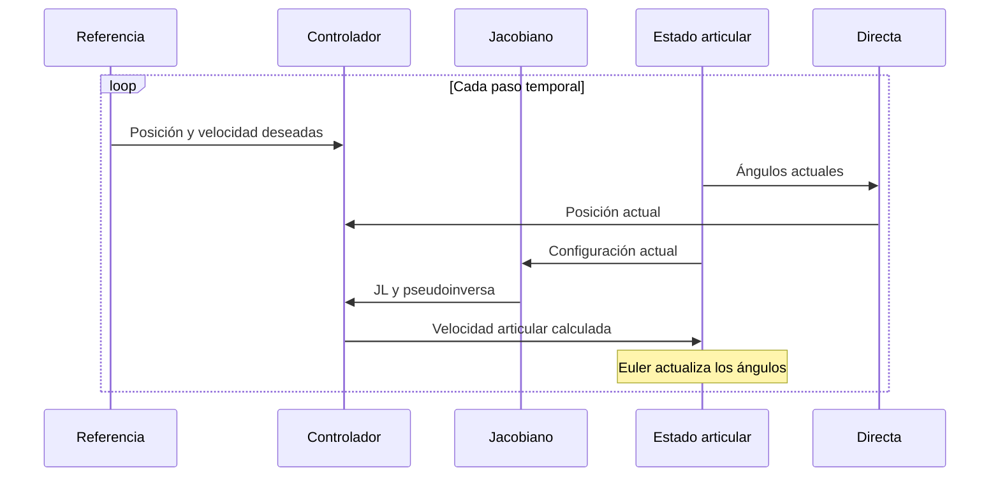
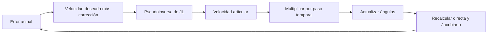

# Kinematic control · control cinemático

[Mapa de estudio](../README.md) · [Notebook ejecutado](study.ipynb) · [Anterior: trayectorias](../trajectories/README.md) · [Opcional: datos sintéticos](../synthetic-data/README.md)

## Qué cambia al cerrar el lazo

En un movimiento prescrito se conocen los ángulos para cada instante. En control, la orden depende del error observado. Se pide una posición o trayectoria, se calcula dónde está el efector y se ajustan las velocidades articulares para reducir la diferencia.

Aquí la posición observada se obtiene de la directa del mismo modelo ideal. No hay sensores reales, torques, dinámica flexible ni saturaciones. El lazo es útil para estudiar la ley cinemática enseñada en clase, sin atribuir al prototipo físico las cifras obtenidas.

## Del error cartesiano a la orden articular

Sea $h=p(q)$ la posición actual y $h_d$ la deseada. Se define $e=h_d-h$: el signo importa, porque un error positivo debe generar una corrección en esa dirección.

Para posición fija:

$$\dot q=J_L^+Ke.$$

Para seguimiento:

$$\dot q=J_L^+(\dot h_d+Ke).$$

$K$ transforma error en velocidad correctora; tiene unidades de 1/s. $\dot h_d$ anticipa el movimiento de la referencia y $Ke$ corrige la desviación. La pseudoinversa $J_L^+$ convierte la velocidad cartesiana solicitada en velocidades articulares. En rango completo y para esta matriz cuadrada coincide con la inversa; en singularidad resuelve un problema de mínimos cuadrados.

## Por qué puede disminuir el error

Se deriva $e=h_d-h$:

$$\dot e=\dot h_d-J_L\dot q.$$

Si $J_LJ_L^+=I$ y se ejecutan idealmente las velocidades de seguimiento:

$$\dot e=\dot h_d-(\dot h_d+Ke)=-Ke.$$

Para ganancia escalar positiva, cada componente decae exponencialmente en el modelo continuo. Esta deducción exige rango completo y realización ideal. En singularidad $J_LJ_L^+$ es una proyección y no se puede cancelar como identidad.

## Del tiempo continuo al bucle de Python

Euler explícito aproxima:

$$q_{k+1}=q_k+\Delta t\dot q_k.$$

La orden se calcula con el estado actual y actualiza el siguiente. Para N intervalos hay N+1 estados y N órdenes: no se integra un paso extra después del instante final.

El notebook usa $\Delta t=0.1$ s y $K=I\ \mathrm{s}^{-1}$. La regla escalar ideal $e_{k+1}\approx(1-K\Delta t)e_k$ ayuda a entender por qué ganancia y paso interactúan; su condición $0<K\Delta t<2$ no es una garantía global para la cinemática no lineal discretizada. Por eso se revisan resultados y se refina el paso.

## Qué hace cada parte del código

| Elemento | Papel |
|---|---|
| `position(q)` | Obtener posición desde el estado articular |
| `linear_jacobian(q)` | Relacionar velocidades en la configuración actual |
| `principal_base_elbows(...)` | Elegir la configuración inicial del seguimiento |
| `reference(t)` | Entregar posición deseada y su derivada analítica |
| `simulate_control(...)` | Repetir medición ideal, error, orden e integración |
| `np.linalg.pinv(JL)` | Convertir la velocidad cartesiana en orden articular |
| `np.linalg.svd(...)` | Vigilar cercanía a singularidades |

Las funciones necesarias están visibles en el notebook. `target=None` selecciona referencia variable; si se entrega un vector, se mantiene un objetivo fijo con velocidad deseada cero. El caso usa siempre ganancias y pasos positivos definidos en las celdas; la rutina de producción añade validación de parámetros.

## Ensayos y lectura de resultados

**Posición fija.** Se parte de $q_0=(0.5,0.6,-0.8)$ rad y se pide la posición de $(-0.3,0.8,-1)$ rad. El error pasa de aproximadamente 0.35948 m a $9.57\times10^{-6}$ m en 10 s. Se controla posición, por lo que no se exige recuperar esos mismos ángulos objetivo. La máxima velocidad articular absoluta observada es 1.512 rad/s; no se afirma que el actuador real la admita.

**Seguimiento.** Se utiliza una referencia sinusoidal adaptada al tamaño del RRR:

$$h_d(t)=\begin{bmatrix}0.35+0.03\cos(0.4t)\\0.10+0.03\sin(0.4t)\\0.23+0.02\sin(0.5t)\end{bmatrix}\mathrm{m}.$$

La condición inicial se obtiene por inversa de $h_d(0)$, con la base de radio positivo y el codo negativo y un desplazamiento articular de $(0.12,-0.08,0.10)$ rad. Este desplazamiento genera el transitorio. El RMSE cartesiano se define como $\sqrt{\frac1N\sum_k\|e_k\|^2}$, sin dividir nuevamente por los tres ejes.

Con paso 0.1 s, el RMSE entre 10–20 s es aproximadamente $2.67\times10^{-4}$ m; al reducir el paso a 0.05 s disminuye a $1.33\times10^{-4}$ m. El RMSE de todo el intervalo de 20 s, incluido el transitorio, es aproximadamente 0.008589 m para paso 0.1 s. Indicar la ventana es necesario para interpretar las cifras.

**Inicio singular.** Desde $q=0$ y con objetivo $(0.50,0,0.04)$ m, la orden permanece nula y el error en 0.03 m. El notebook conserva este caso como evidencia de una limitación del controlador.

## Relación con curso y paper

La ley y Euler explícito proceden de los ejemplos de semana 9. Allí se usa un robot de cuatro articulaciones; aquí se adaptan a las tres del paper, con sus dimensiones nominales. La referencia, las condiciones iniciales y la duración son escenarios propios declarados, no ensayos físicos replicados del artículo.

**Ejercicio:** modificar primero el paso y luego la ganancia. Observar error, velocidad articular y menor valor singular conjuntamente. Que disminuya una métrica en un ejemplo no prueba estabilidad general.

[Resultados originales](../../simulations/course/README.md) · [Implementación reutilizable](../../code/course.py) · [Correspondencia con clases](../../docs/course-alignment.md).
