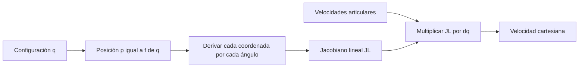
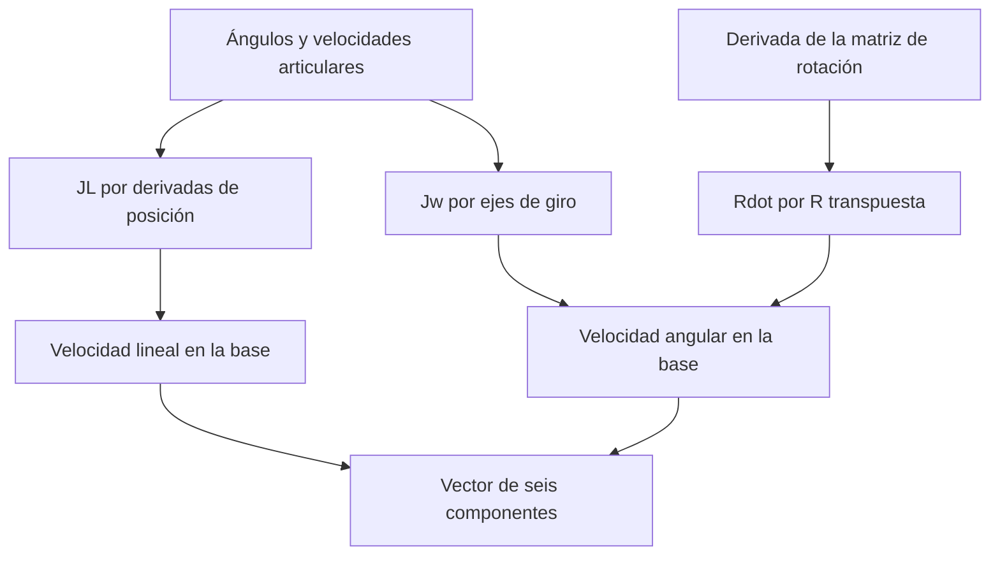

# Differential kinematics · cinemática diferencial

[Mapa de estudio](../README.md) · [Notebook ejecutado](study.ipynb) · [Anterior: inversa](../inverse-kinematics/README.md) · [Siguiente: singularidades](../singularities/README.md)

## Qué problema resuelve

La directa responde dónde está el efector. La diferencial explica cómo se mueve **en ese instante** cuando giran las articulaciones. El efecto de una misma velocidad articular depende de la configuración: una palanca extendida y una plegada no producen el mismo movimiento en el extremo.

El punto de partida es $p=f(q)$. Para incrementos pequeños:

$$\Delta p\approx J_L(q)\Delta q.$$

Al aplicar la regla de la cadena a $q(t)$ se obtiene:

$$\dot p=J_L(q)\dot q,\qquad (J_L)_{ij}=\frac{\partial p_i}{\partial q_j}.$$

La relación instantánea de velocidades es exacta para este modelo diferenciable; aproximar un desplazamiento finito mediante un único Jacobiano sí introduce error. El Jacobiano debe reevaluarse al cambiar la configuración.

## Leer una matriz de derivadas

Las filas corresponden a x, y, z. Las columnas corresponden a base, hombro y codo. La primera columna responde qué ocurre con el efector si sólo gira la base a 1 rad/s. La segunda hace lo mismo para el hombro, y la tercera para el codo.

La multiplicación $J_L\dot q$ suma las tres contribuciones. No hay una columna asociada a un punto distinto del robot: todas describen la velocidad del mismo efector.

Se conservan las abreviaturas de la directa:

$$\rho=l_2\cos q_2+l_3\cos(q_2+q_3),\quad h=l_2\sin q_2+l_3\sin(q_2+q_3).$$

Sus derivadas auxiliares son:

| Derivada | Resultado | Motivo |
|---|---|---|
| $\partial\rho/\partial q_2$ | $-h$ | Derivar ambos cosenos |
| $\partial\rho/\partial q_3$ | $-l_3\sin(q_2+q_3)$ | Sólo depende el último eslabón |
| $\partial h/\partial q_2$ | $\rho$ | Derivar ambos senos |
| $\partial h/\partial q_3$ | $l_3\cos(q_2+q_3)$ | Sólo depende el último eslabón |

Con $c_1=\cos q_1$, $s_1=\sin q_1$, $c_{23}=\cos(q_2+q_3)$ y $s_{23}=\sin(q_2+q_3)$:

$$J_L=\begin{bmatrix}
-s_1\rho&-c_1h&-l_3c_1s_{23}\\
c_1\rho&-s_1h&-l_3s_1s_{23}\\
0&\rho&l_3c_{23}
\end{bmatrix}.$$

Por ejemplo, $\partial p_x/\partial q_2=c_1\partial\rho/\partial q_2=-c_1h$. El cero inferior izquierdo expresa que girar la base no cambia la altura. $l_1$ desaparece porque es un desplazamiento constante, aunque sigue presente en la directa y en la inversa.

Con ángulos en radianes, las entradas de $J_L$ se interpretan en m/rad; al multiplicar por rad/s se obtienen m/s. Convertir sólo la posición a grados y olvidar las unidades de la derivada introduce un factor de escala incorrecto.

## Una segunda construcción: geometría del giro

Para una articulación rotacional, la velocidad tangente es:

$$J_{L,i}=z_{i-1}\times(p-o_{i-1}).$$

$z_{i-1}$ es el eje unitario de giro y $o_{i-1}$ un punto de ese eje, ambos expresados en la base. El vector $p-o_{i-1}$ es el brazo de palanca. El producto cruzado proporciona la dirección tangente y su magnitud depende de la distancia al eje.

En este modelo:

$$z_0=(0,0,1)^T,\qquad z_1=z_2=(s_1,-c_1,0)^T.$$

Los orígenes son $o_0=0$, $o_1=(0,0,l_1)^T$ y el codo calculado por directa. El notebook compara productos cruzados con las derivadas; no valida una fórmula sólo contra otra copia literal.

## La parte angular es otra relación

Las velocidades angulares de las articulaciones rotacionales se suman a través de sus ejes:

$$J_\omega=[z_0\ z_1\ z_2]=\begin{bmatrix}0&s_1&s_1\\0&-c_1&-c_1\\1&0&0\end{bmatrix},\qquad \omega=J_\omega\dot q.$$

El Jacobiano completo empleado es:

$$\begin{bmatrix}\dot p\\\omega\end{bmatrix}=\underbrace{\begin{bmatrix}J_L\\J_\omega\end{bmatrix}}_{J\in\mathbb R^{6\times3}}\dot q.$$

Es una matriz 6×3 y no tiene determinante. Tener seis filas no crea seis entradas independientes. Además, $\omega$ no es en general la derivada de una terna de ángulos de Euler: esa parametrización requiere otro Jacobiano. Se verifica la parte angular mediante $[\omega]_\times=\dot R R^T$.

## Cómo se comprueba en el notebook

1. Se calcula el ejemplo $q=(30,40,-50)^\circ$, $\dot q=(0.10,-0.20,0.15)$ rad/s. Debe dar $v\approx(0.007557,0.057307,-0.056248)$ m/s y $\omega\approx(-0.025,0.043301,0.1)$ rad/s.
2. Se perturba un ángulo a la vez y se aproxima cada columna con diferencias centrales. Aquí el incremento es angular.
3. Se construyen las columnas mediante productos cruzados y se contrasta la velocidad angular con $\dot R R^T$.
4. Se prescribe una trayectoria y se compara $J_L\dot q$ con $[p(t+\Delta t)-p(t-\Delta t)]/(2\Delta t)$. Aquí el incremento es temporal.

El caso utiliza los mismos senos, cosenos y pasos que `simulations/differential`. Con $\Delta t=0.01$ s, el error máximo es aproximadamente $3.99\times10^{-7}$ m/s. Al dividir el paso por dos, disminuye aproximadamente cuatro veces: el comportamiento esperado de una diferencia central en este intervalo. Los extremos se excluyen porque no tienen vecino a ambos lados.

Un error pequeño comprueba coherencia matemática y numérica. No mide precisión experimental ni demuestra funcionamiento del control. La trayectoria de este notebook está prescrita; todavía no se corrige un error deseado–real.

**Ejercicio:** usar una velocidad articular unitaria en cada articulación y explicar la columna correspondiente antes de mirar la gráfica.

Fuentes: semanas 6 y 7; directa nominal derivada del paper. [Nota matemática complementaria](../../docs/differential.md) · [Modelo reutilizable](../../code/model.py) · [Experimento original](../../simulations/differential/README.md).
