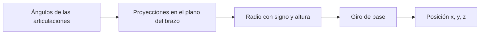

# Forward kinematics · cinemática directa

[Mapa de estudio](../README.md) · [Notebook ejecutado](study.ipynb) · [Siguiente: inversa](../inverse-kinematics/README.md)

## La idea antes de la ecuación

Conocer cuánto gira cada articulación permite calcular dónde termina el brazo. No se está buscando un movimiento ni corrigiendo un error: se evalúa una configuración. El robot tiene una base que gira en torno a z, un hombro y un codo. El pedestal mide $l_1=0.04$ m; los eslabones móviles, $l_2=0.29$ m y $l_3=0.24$ m.

Se adopta $q=0$ con ambos eslabones móviles extendidos sobre +x, a altura $l_1$. Esa postura de referencia define los signos de las ecuaciones. El ángulo del codo es relativo al primer eslabón: por eso la inclinación absoluta del último es $q_2+q_3$.

## Método geométrico

En el plano vertical que contiene los eslabones se suman proyecciones:

$$\rho=l_2\cos q_2+l_3\cos(q_2+q_3),$$
$$h=l_2\sin q_2+l_3\sin(q_2+q_3).$$

$\rho$ es una coordenada radial con signo; puede ser negativa si los eslabones se proyectan detrás del eje. $h$ es altura respecto del hombro. Al girar ese plano alrededor de la base:

$$p_x=\rho\cos q_1,\qquad p_y=\rho\sin q_1,\qquad p_z=l_1+h.$$

El giro de base cambia x e y, pero no z. El pedestal desplaza z, pero no cambia las longitudes de los triángulos del brazo. Estas dos observaciones permiten detectar errores antes de usar matrices.

## Por qué hacen falta marcos y matrices

Las proyecciones obtienen posición, pero el efector también tiene orientación. Una rotación $R$ describe sus tres ejes como columnas. Debe cumplir $R^TR=I$ y $\det R=1$: conserva ángulos, longitudes y orientación de un marco derecho.

La transformación homogénea combina rotación y desplazamiento:

$$M=\begin{bmatrix}R&p\\0&1\end{bmatrix}.$$

La cuarta coordenada permite escribir $Rx+p$ como una sola multiplicación matricial. La última fila es `[0,0,0,1]`, no una fila nula. $M_{03}$ lleva coordenadas del marco 3 a la base; su cuarta columna indica dónde está el origen 3 visto desde la base.

Por eso $M_{03}=M_{01}M_{12}M_{23}$. Al aplicarlo a un vector columna, la operación más a la derecha actúa primero. Cambiar el orden de los factores cambia el resultado.

## DH como regla de construcción

Denavit–Hartenberg organiza cuatro movimientos por articulación:

$$M_{i-1,i}=R_z(\theta_i)T_z(d_i)T_x(a_i)R_x(\alpha_i).$$

`theta` gira alrededor del eje articular; `d` desplaza sobre z; `a` desplaza sobre x; `alpha` gira alrededor de x para alinear el eje siguiente. En este RRR sólo varían los tres `theta`.

| Tramo | theta | d | a | alpha |
|---|---|---|---|---|
| 0 → 1 | $q_1$ | $l_1$ | 0 | $\pi/2$ |
| 1 → 2 | $q_2$ | 0 | $l_2$ | 0 |
| 2 → 3 | $q_3$ | 0 | $l_3$ | 0 |

El giro fijo $\alpha_1=\pi/2$ orienta los ejes de hombro y codo. No es una cuarta articulación. La tabla coincide estructuralmente con el RRR de semana 7; las dimensiones se sustituyen por las del paper. Los ejemplos SCARA de otras semanas incluyen una articulación prismática y no se copian directamente.

## Cómo se ve en Python

| Código del notebook | Ecuación o función |
|---|---|
| `position(q)` | Sumar proyecciones y aplicar el giro de base |
| `dh(theta,d,a,alpha)` | Construir una transformación con la tabla |
| `M01 @ M12 @ M23` | Componer marcos |
| `M03[:3,3]` | Extraer posición |
| `M03[:3,:3]` | Extraer orientación |
| `rotation_z` y `translation` | Contrastar DH con movimientos elementales explícitos |
| `joint_points(q)` | Dibujar base, hombro, codo y efector |

La función `position` implementa las ecuaciones línea por línea. La función `dh` conserva el orden de argumentos de clase y convierte todos los ángulos a radianes. `np.allclose` admite pequeñas diferencias de redondeo entre métodos.

## Qué se replica y cómo se comprueba

Se parte de la tabla DH y las dimensiones del paper, pero se reconstruyen las matrices por inconsistencias tipográficas registradas en la [lectura documental](../../docs/paper.md). El notebook compara posición geométrica, transformación por movimientos elementales y DH; además comprueba ortogonalidad y determinante de la rotación.

Con $q=(30,40,-50)^\circ$, debe obtenerse aproximadamente $p=(0.397078,0.229253,0.184733)$ m. Se muestrean también 9261 combinaciones articulares con rangos ilustrativos del curso. Esa nube ayuda a ver alcance geométrico; no incorpora colisiones ni demuestra límites físicos.

**Comprobación conceptual:** con $q=0$ se obtiene $(0.53,0,0.04)$ m. Cambiar sólo el ángulo de base debe conservar la altura y la distancia al eje z. Si no ocurre, deben revisarse marcos, unidades o signos.

Fuentes: paper, tablas 1–2 y ecs. 6–8; materiales de semanas 4 y 7, localizados en [assets/utility](../../assets/utility/README.md). Implementaciones reutilizables: [model.py](../../code/model.py) y [course.py](../../code/course.py).
