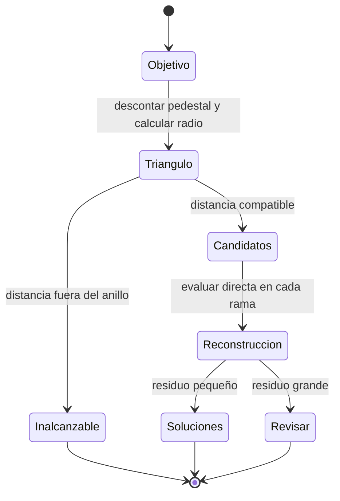
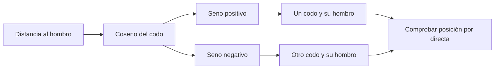

# Inverse kinematics · cinemática inversa

[Mapa de estudio](../README.md) · [Notebook ejecutado](study.ipynb) · [Anterior: directa](../forward-kinematics/README.md) · [Siguiente: diferencial](../differential-kinematics/README.md)

## El cambio de pregunta

La directa evalúa una configuración conocida. La inversa parte de un objetivo cartesiano y busca configuraciones que lo alcanzan. No consiste simplemente en invertir una matriz: la relación entre ángulos y posición contiene senos y cosenos, puede tener varias soluciones y puede no tener ninguna.

Este desarrollo resuelve **posición**, no una pose arbitraria de seis componentes. La orientación final queda vinculada a los ángulos hallados. Se comienza con la familia de base principal, cuyo radio es no negativo.

## Pasar del espacio al plano

Para $p_d=(x,y,z)$:

$$r=\sqrt{x^2+y^2},\quad h=z-l_1,\quad D=\sqrt{r^2+h^2}.$$

$r$ mide distancia al eje de base. $h$ mide altura respecto del hombro, que es el origen del triángulo. $D$ es distancia hombro–objetivo. Se elige $q_1=\operatorname{atan2}(y,x)$ cuando $r>0$.

`atan2(y,x)` utiliza el signo de ambas coordenadas y distingue cuadrantes. `atan(y/x)` pierde esa información y falla cuando x es cero. En el eje, x=y=0, la posición no determina $q_1$; el notebook devuelve un representante igual a cero.

## Primero comprobar si existe el triángulo

Dos eslabones de longitudes $l_2$ y $l_3$ llegan a distancias entre su diferencia y su suma:

$$|l_2-l_3|\leq D\leq l_2+l_3.$$

Para el modelo son 0.05 y 0.53 m. El límite inferior explica un hueco interior alrededor del hombro. Un objetivo no es necesariamente alcanzable por estar cerca de la base.

Esta condición ignora límites articulares y colisiones. Que exista una solución matemática no significa que el robot construido pueda adoptarla.

## Encontrar codo y hombro

La ley de cosenos, usando un codo articular cero al extenderse, produce:

$$C_3=\cos q_3=\frac{D^2-l_2^2-l_3^2}{2l_2l_3}.$$

El ángulo interior del triángulo es suplementario al ángulo usado aquí. Copiar una fórmula sin reconciliar esa convención cambia el signo. A partir de $C_3$:

$$S_3=\pm\sqrt{1-C_3^2},\qquad q_3=\operatorname{atan2}(S_3,C_3).$$

Los dos signos corresponden a dos posturas del codo. Para el hombro se resta a la dirección del objetivo el ángulo que el segundo eslabón introduce en el triángulo:

$$q_2=\underbrace{\operatorname{atan2}(h,r)}_{\text{dirección del objetivo}}-\underbrace{\operatorname{atan2}(l_3S_3,l_2+l_3C_3)}_{\text{desvío del triángulo}}.$$

## Leer la implementación

`np.hypot(x,y)` calcula el radio. El `if` rechaza cosenos fuera de [-1,1] más allá del redondeo; `np.clip` sólo corrige una pequeña desviación numérica en la frontera. Recortar cualquier objetivo inalcanzable a ese intervalo produciría soluciones falsas.

El bucle `for sign in [1,-1]` genera las ramas. Cada candidato se evalúa con `position(candidate)`. El residuo $\|f(q)-p_d\|$ debe ser pequeño. Comparar el candidato con los ángulos originales no sería una validación adecuada, porque otra postura también puede ser solución.

En el ejemplo de la directa, una rama recupera aproximadamente $(30,40,-50)^\circ$. El notebook dibuja ambas en el plano radial. Los dos extremos coinciden, pero los codos quedan en posiciones distintas.

## Casos que requieren interpretación

- En extensión o plegado, las dos ramas pueden coincidir. El notebook mantiene los dos candidatos para mostrar su origen; `course.py` elimina duplicados.
- En el eje de base existe indeterminación de $q_1$. Elegir cero sólo selecciona un representante.
- No se enumeran las familias con base girada $\pi$ y coordenada radial negativa, ni vueltas equivalentes de $2\pi$.
- Las dimensiones actuales son distintas, $l_2\ne l_3$. La rutina reutilizable incluye además el caso degenerado de eslabones iguales completamente plegados.

**Ejercicio:** comparar un objetivo exterior, uno dentro del hueco y uno sobre la frontera. Explicar el resultado geométricamente antes de leer los ángulos.

Fuentes: métodos geométricos de semanas 5 y 7; convenciones y discrepancias de inversa del paper en [docs/paper.md](../../docs/paper.md). El desarrollo se comprueba con la directa reconstruida y no presupone correctas todas las expresiones impresas del artículo. [Código reutilizable](../../code/course.py).
