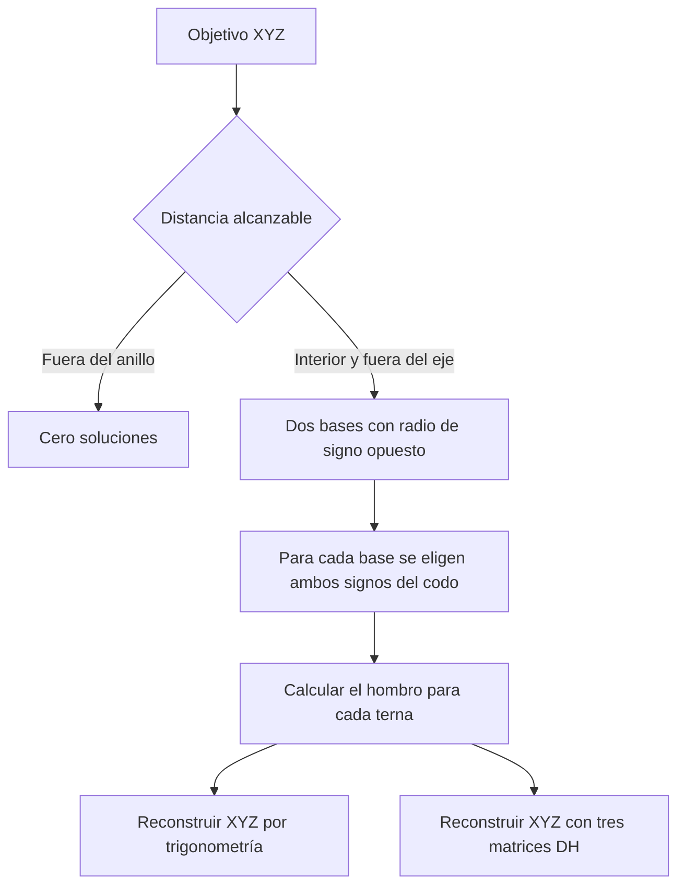

# Inverse kinematics · cinemática inversa

[Notebook ejecutado](study.ipynb) · [Mapa de estudio](../README.md) · [Directa](../forward-kinematics/README.md) · [Diferencial](../differential-kinematics/README.md)

Dado un punto $(x,y,z)$ en metros, se buscan los ángulos de base, hombro y codo que llevan el efector a ese punto. La tarea especifica **posición**. Cada terna puede producir una orientación distinta.

## Por qué aparecen dos bases

La directa proyecta los eslabones sobre el plano horizontal. La proyección firmada es $\rho=l_2\cos q_2+l_3\cos(q_2+q_3)$. Puede ser negativa cuando el brazo se extiende hacia atrás respecto de su base. Las coordenadas cumplen $x=\rho\cos q_1$ e $y=\rho\sin q_1$.

La distancia horizontal $r=\sqrt{x^2+y^2}$ se obtiene con `np.hypot(x, y)`. Para $r>0$, si $\phi=\operatorname{atan2}(y,x)$, hay dos maneras de reconstruir el mismo par $(x,y)$.

| Base | Proyección en el plano de esa base |
|---|---|
| $q_1=\phi$ | $\rho=+r$ |
| $q_1=\phi+\pi$ | $\rho=-r$ |

Al girar media vuelta cambian los signos del seno y del coseno de la base. El signo de $\rho$ compensa ambos cambios. La altura permanece igual. `atan2` conserva el cuadrante incluso cuando $x=0$.

## Resolver hombro y codo

El hombro está a altura $l_1$. En su plano, el objetivo queda en $(\rho,h)$, con $h=z-l_1$. La distancia al hombro es $D=\sqrt{r^2+h^2}$. Con los dos eslabones de 0.29 y 0.24 m, el triángulo existe si $0.05\leq D\leq0.53$ m.

Por ley de cosenos, con el codo extendido como cero articular,

$$C_3=\frac{D^2-l_2^2-l_3^2}{2l_2l_3},\qquad q_3=\pm\arccos(C_3).$$

Doblar el codo hacia uno u otro lado conserva la distancia $D$. Para cada combinación de base y codo, la dirección del objetivo en el plano es $\operatorname{atan2}(h,\rho)$. Se le resta el ángulo entre el primer eslabón y la línea hombro–objetivo para obtener el hombro.

$$q_2=\operatorname{atan2}(h,\rho)-\operatorname{atan2}(l_3\sin q_3,\,l_2+l_3\cos q_3).$$

## Reproducir el punto de la presentación

La configuración $(30,60,-60)^\circ$ define el objetivo $(0.333420,\,0.192500,\,0.291147)$ m. La tabla muestra ángulos redondeados. El notebook conserva la precisión completa para reconstruir el objetivo.

| Proyección $\rho$ (m) | Base $q_1$ | Hombro $q_2$ | Codo $q_3$ |
|---:|---:|---:|---:|
| +0.385 | 30° | 6.24° | 60° |
| +0.385 | 30° | 60° | −60° |
| −0.385 | −150° | 120° | 60° |
| −0.385 | −150° | 173.76° | −60° |

El notebook anterior partía de $(30,40,-50)^\circ$, que da otro objetivo, aproximadamente $(0.397078,0.229253,0.184733)$ m. Además, recorría los dos codos sólo para $+r$. Al compartir objetivo y enumerar ambos radios, las cuatro ternas coinciden con el caso regular del otro repositorio, salvo vueltas completas. [Código de referencia](https://github.com/melissaaylasb-sudo/ramzy-3r-python-grupo-3/blob/ae47b3b99bc139ecaaf19cc35bf81d96ae9bff3f/ramzy3r/kinematics.py) · [Resultados de referencia](https://github.com/melissaaylasb-sudo/ramzy-3r-python-grupo-3/blob/ae47b3b99bc139ecaaf19cc35bf81d96ae9bff3f/resultados/inversa.csv) · [Presentación, diapositivas 21 y 24](https://docs.google.com/presentation/d/1xRyUybBlr8cZ4NNBNHq8ZxaJdT1x7GR5/edit)

## Leer la comprobación en NumPy

1. `position` calcula $x,y,z$ por proyección de longitudes. Se usa una vez para fijar el objetivo compartido.
2. Dos bucles recorren las bases y los codos. Cada par determina un único $q_2$ en el caso regular. Se expresan los ángulos módulo una vuelta.
3. `dh_position` multiplica `M01 @ M12 @ M23` según la tabla DH del curso. La traslación de la última columna da una segunda reconstrucción de la posición.
4. Para cada terna se calculan dos distancias $\|p_{\mathrm{calculado}}-p_{\mathrm{objetivo}}\|_2$. En las cuatro posturas del ejemplo, ambos errores quedan por debajo de $10^{-12}$ m. En la gráfica, cada panel utiliza el eje radial de su propia base.

## Qué cambia en los casos singulares

- En extensión o plegado, las dos elecciones de codo coinciden módulo una vuelta. Fuera del eje quedan dos ternas, una por base.
- En el eje, la base puede tomar cualquier ángulo. Se muestra un representante de 0° por codo distinto. En la intersección del eje con una frontera queda un representante.
- Dentro del hueco o más allá del alcance exterior se obtiene una lista vacía. Con eslabones de igual longitud, el plegado completo en el hombro también deja libre $q_2$.
- La admisibilidad de una rama en el robot físico depende de sus límites articulares y de las colisiones. Las cuatro filas corresponden al modelo geométrico.

Los casos de frontera y la recuperación de configuraciones aleatorias se comprueban en las [pruebas en Python](../../code/tests/test_course.py). Los fundamentos del curso y las convenciones del artículo se describen en la [alineación con las clases](../../docs/course-alignment.md) y la [lectura del paper](../../docs/paper.md).
