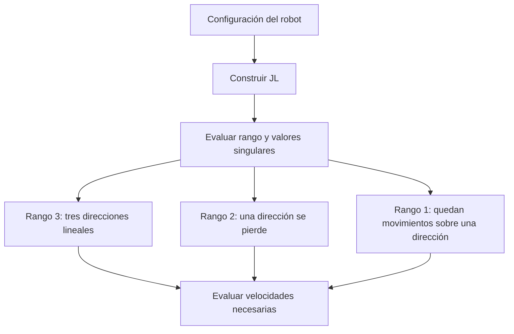
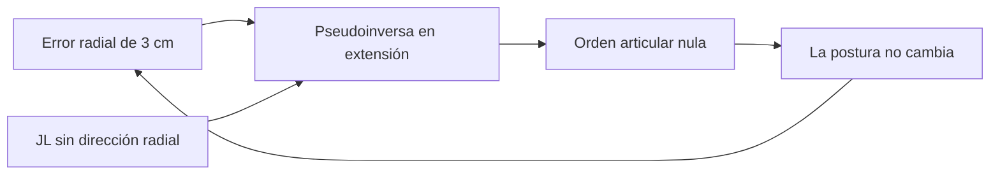

# Singularities · singularidades

[Mapa de estudio](../README.md) · [Notebook ejecutado](study.ipynb) · [Anterior: diferencial](../differential-kinematics/README.md) · [Siguiente: trayectorias](../trajectories/README.md)

## La intuición: motores disponibles y direcciones disponibles

El Jacobiano convierte tres velocidades articulares en velocidad cartesiana. Sus columnas son tres contribuciones de movimiento. Si una columna se vuelve nula o depende de las otras, algunas direcciones cartesianas ya no se pueden producir instantáneamente.

El **rango** cuenta las direcciones independientes. Para una tarea de posición tridimensional se busca rango 3. Una postura con rango menor es singular para esa tarea. No significa que el brazo desaparezca, deje de tener tres motores o no pueda moverse en absoluto; significa que su capacidad local de movimiento se ha reducido.

## Por qué se usa el determinante

Para una matriz cuadrada 3×3, determinante cero equivale a falta de rango completo. Geométricamente, las columnas dejan de formar un volumen tridimensional. Para el Jacobiano de posición del RRR:

$$\det J_L=-l_2l_3\rho\sin q_3,\qquad \rho=l_2\cos q_2+l_3\cos(q_2+q_3).$$

Las longitudes son positivas. Por tanto, las causas son:

| Factor nulo | Geometría | Efecto local |
|---|---|---|
| $\sin q_3=0$ | Eslabones móviles alineados, extendidos o plegados | El movimiento planar pierde una dirección independiente |
| $\rho=0$ | Efector sobre el eje de base | Girar la base no desplaza ese punto |
| Ambos | Alineación sobre el eje de base | El rango puede bajar aún más |

En $q=(0,0,0)$ el extremo está sobre +x: los movimientos del hombro y codo son verticales y el giro de base es lateral. Falta la dirección radial x. En $q=(0,\pi/2,0)$ el brazo está vertical sobre la base: el giro de base no cambia la posición y las otras dos columnas son dependientes.

## Singularidad de qué tarea

El Jacobiano completo $J=[J_L;J_\omega]$ tiene forma 6×3. No tiene determinante y no debe confundirse con $J_L$. Sus columnas pueden seguir siendo independientes cuando se considera también la orientación.

Para $l_2>0$, si $Ju=0$, la parte angular exige $u_1=0$ y $u_2=-u_3$. La parte lineal restante tiene norma $l_2|u_2|$, de modo que sólo puede anularse con $u_2=0$. Por tanto, $u=0$ y el Jacobiano completo conserva rango de columna 3 en este modelo.

Esto no permite imponer una velocidad arbitraria de seis componentes: el espacio de salidas sigue teniendo como máximo dimensión 3. Tampoco convierte en regular la tarea de posición cuando $J_L$ pierde rango.

## Cerca de la singularidad: valores singulares

El determinante indica la condición exacta de singularidad, pero un valor pequeño depende de las escalas y unidades. La descomposición en valores singulares escribe $J_L=U\Sigma V^T$: separa direcciones articulares, factores de escala y direcciones cartesianas.

El menor factor, $\sigma_{\min}$, mide la respuesta en la dirección peor transmitida. Si es muy pequeño, una pequeña velocidad cartesiana en esa dirección puede requerir una gran velocidad articular. El cociente $\sigma_{\max}/\sigma_{\min}$ describe el condicionamiento cuando el rango es completo.

El notebook dibuja $\sigma_{\min}$ y el determinante al barrer el codo, con hombro fijo. Se analizan sólo los valores singulares de $J_L$, cuyas filas tienen unidades homogéneas. Comparar directamente con los del Jacobiano completo mezclaría escalas lineales y angulares.

## Por qué la pseudoinversa no basta

La pseudoinversa busca una solución de mínimos cuadrados y, entre las equivalentes, la de menor norma. Si la velocidad solicitada queda fuera de las direcciones alcanzables instantáneamente, devuelve la mejor proyección disponible; no crea la dirección que falta.

En $q=0$, la posición es $(0.53,0,0.04)$ m. Se pide $(0.50,0,0.04)$ m. El error radial es $(-0.03,0,0)$ m y la ley $\dot q=J_L^+e$, con ganancia 1/s, produce orden nula. El objetivo puede alcanzarse doblando el brazo, pero esta ley local no inicia ese movimiento desde la postura exacta.

## Cómo leer el notebook

`np.linalg.matrix_rank` cuenta valores singulares significativos, con tolerancia explícita. `np.linalg.det` se compara con la factorización matemática. `np.linalg.svd(..., compute_uv=False)` devuelve los factores, ordenados de mayor a menor; `[-1]` selecciona el mínimo. `np.linalg.pinv` muestra el resultado de pedir una dirección perdida.

Los ejemplos deben dar rangos de $J_L$ iguales a 3, 2 y 1, mientras el completo conserva rango 3. El caso radial debe mantener un error de 0.03 m. Una inversa amortiguada podría reducir la amplificación cerca de una singularidad, pero tampoco recupera direcciones ausentes; su ajuste no forma parte de este ensayo.

**Ejercicio:** modificar levemente el codo y observar tanto el error como la magnitud de la orden. Una matriz ya invertible puede seguir estando mal condicionada.

Fuentes: semanas 6–7 y Jacobiano derivado de la geometría nominal. [Desarrollo diferencial](../../docs/differential.md) · [Comprobaciones del modelo](../../code/tests/test_model.py).
