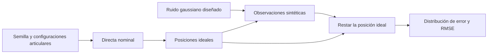

# Synthetic data · datos sintéticos con ruido

[Mapa de estudio](../README.md) · [Notebook ejecutado](study.ipynb)

## Propósito de este caso opcional

Cuando no se dispone de mediciones reales, se puede construir un conjunto artificial para probar el procesamiento. Se conoce una verdad ideal, se añade ruido con distribución conocida y se comprueba si las métricas recuperan su escala.

La verdad de este ejemplo también procede del modelo: no es *ground truth* medido en laboratorio. Por ello el caso verifica el generador y el cálculo de errores, pero no valida la precisión del VSL ni sustituye los ensayos del paper.

## Modelo de observación

Se generan 500 configuraciones con cada ángulo uniforme en [-1,1] rad. La directa produce $p_i$. Se añade ruido independiente por eje:

$$y_i=p_i+\epsilon_i,\qquad \epsilon_i\sim\mathcal N(0,\sigma^2I),\quad \sigma=0.002\ \mathrm{m}.$$

`np.random.default_rng(2026)` fija una semilla para repetir las muestras. `uniform` genera ángulos y `normal` genera ruido. La desviación de 2 mm es una elección del experimento, no una especificación del fabricante.

## Qué mide el RMSE

El error de una observación es $e_i=y_i-p_i$. Su norma combina x, y, z. El RMSE cartesiano es:

$$\mathrm{RMSE}=\sqrt{\frac1N\sum_{i=1}^N\|e_i\|^2}.$$

Al ser tres componentes independientes de varianza $\sigma^2$, se cumple $\mathbb E[\|e_i\|^2]=3\sigma^2$. La escala de referencia del RMSE es entonces $\sqrt3\sigma\approx0.003464$ m. No debe confundirse con el RMSE por componente, ni con una afirmación de que la esperanza de la raíz sea exactamente la raíz de la esperanza.

Con la semilla y el tamaño elegidos, el valor observado es aproximadamente 0.003505 m. La comprobación admite una banda del 15% alrededor de la escala teórica; esa banda valida este fixture, no la calidad de un robot.

## Lectura del notebook

El histograma reúne componentes de error y debe mostrar una distribución centrada cerca de cero. La segunda gráfica muestra normas, siempre no negativas, por observación. La línea horizontal del RMSE resume la magnitud global; no es un límite que cada muestra deba respetar.

Cambiar la semilla modifica las muestras. Duplicar $\sigma$ duplica la escala del error. Aumentar el número de observaciones suele estabilizar la estimación. Ninguna de esas operaciones genera evidencia experimental sobre el prototipo.

Este ruido no se inyecta automáticamente en los notebooks de control. Es una prueba independiente del flujo de datos. Se usan los mismos parámetros y el mismo orden de generación que el [caso dummy-sensor](../../simulations/dummy-sensor/README.md).
