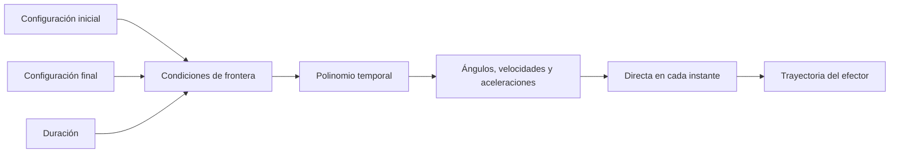

# Trajectories · generación de trayectorias

[Mapa de estudio](../README.md) · [Notebook ejecutado](study.ipynb) · [Anterior: singularidades](../singularities/README.md) · [Siguiente: control](../control/README.md)

## De una lista de posturas a un movimiento

Dos configuraciones, inicial y final, no indican cuándo pasa el robot por cada posición ni con qué velocidad. Una trayectoria añade una ley temporal. Un camino describe la geometría recorrida; una trayectoria describe además cómo se recorre en el tiempo.

Se trabaja en espacio articular: los valores interpolados son ángulos. Si los extremos se conocen en coordenadas cartesianas, primero puede usarse la inversa para elegir configuraciones compatibles. En el ejemplo los ángulos extremos ya están dados, por lo que no se necesita resolver de nuevo la inversa.

## Separar la distancia articular del progreso

Se escribe:

$$q(t)=q_i+\Delta q\,s(u),\qquad \Delta q=q_f-q_i,\quad u=t/T.$$

$u$ es tiempo normalizado entre 0 y 1. La misma función escalar $s$ coordina las tres articulaciones. El vector $\Delta q$ fija cuánto debe moverse cada una.

Para empezar y terminar en las posturas pedidas se exige $s(0)=0$ y $s(1)=1$. Para comenzar y terminar en reposo se añaden $s'(0)=s'(1)=0$.

## Cómo aparece la cúbica

Un polinomio cúbico tiene cuatro coeficientes: $s=a_0+a_1u+a_2u^2+a_3u^3$. Las cuatro condiciones anteriores determinan los cuatro coeficientes. Las iniciales dan $a_0=a_1=0$; las finales dan $a_2+a_3=1$ y $2a_2+3a_3=0$. De ahí:

$$s_3=3u^2-2u^3.$$

Sus derivadas temporales son:

$$\dot s_3=\frac{6u-6u^2}{T},\qquad \ddot s_3=\frac{6-12u}{T^2}.$$

La velocidad es nula en extremos; la aceleración no. Si el robot estaba quieto antes y queda quieto después, ese empalme tiene un salto de aceleración.

## Qué añade la quíntica

Para imponer además $s''(0)=s''(1)=0$ se necesitan seis condiciones y seis coeficientes. Las condiciones iniciales anulan los tres primeros. Las finales resuelven:

$$a_3+a_4+a_5=1,\quad 3a_3+4a_4+5a_5=0,\quad 6a_3+12a_4+20a_5=0.$$

Así se obtiene:

$$s_5=10u^3-15u^4+6u^5,$$
$$\dot s_5=\frac{30u^2-60u^3+30u^4}{T},\qquad
\ddot s_5=\frac{60u-180u^2+120u^3}{T^2}.$$

En ambos casos, $\dot q=\Delta q\dot s$ y $\ddot q=\Delta q\ddot s$. El subíndice 3 o 5 indica orden del polinomio, no número de articulación.

## La duración también importa

Duplicar $T$ conserva el mismo camino y reduce velocidades a la mitad y aceleraciones a la cuarta parte, comparando el mismo progreso normalizado. Esto resulta de los factores $1/T$ y $1/T^2$, no de un efecto dinámico simulado.

El ejemplo dura 3 s y une $(30,40,-50)^\circ$ con $(-20,20,-70)^\circ$. Todos los cálculos se hacen en radianes. La cúbica tiene aceleración máxima absoluta de extremo cercana a 0.582 rad/s²; la quíntica, cero.

## Cómo se conecta el código

`np.linspace` construye los instantes. `s3`, `ds3`, `dds3` y sus equivalentes quínticos implementan directamente las ecuaciones. `s[:,None]` transforma un vector de N instantes en una columna N×1; al multiplicarla por las tres componentes de `delta` se obtiene una matriz N×3.

Las filas primera y última comprueban las condiciones de frontera. Las nueve gráficas muestran posición, velocidad y aceleración de las tres articulaciones. Finalmente se aplica `position(q)` a cada fila y se compara el camino del efector con la recta que une sus extremos.

En este ejemplo ambos polinomios recorren el mismo segmento en espacio articular y la misma curva geométrica del efector, con diferente parametrización temporal. Esa curva cartesiana no suele ser una recta.

La suavidad temporal no garantiza límites de velocidad, ausencia de colisiones ni ausencia de singularidades. Tampoco es control: la referencia está prescrita. El siguiente tema estudia cómo corregir errores al seguir una referencia.

Fuentes: interpoladores de semana 8, adaptados al RRR del paper. [Implementación reutilizable](../../code/course.py) · [Caso y parámetros](../../simulations/course/config.json).
