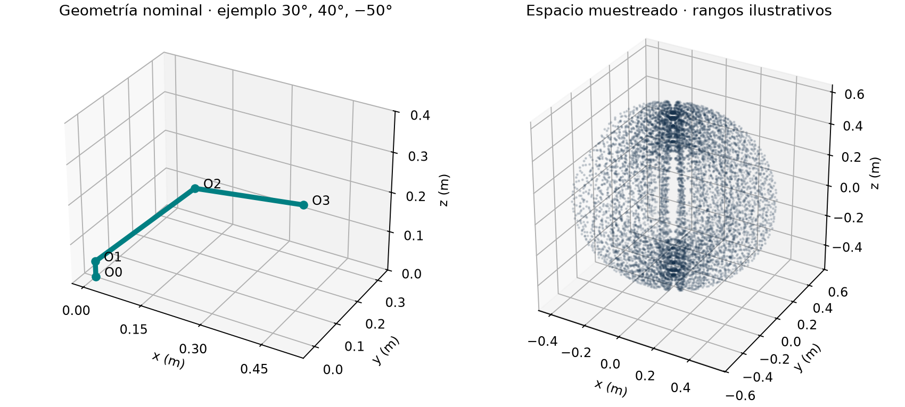
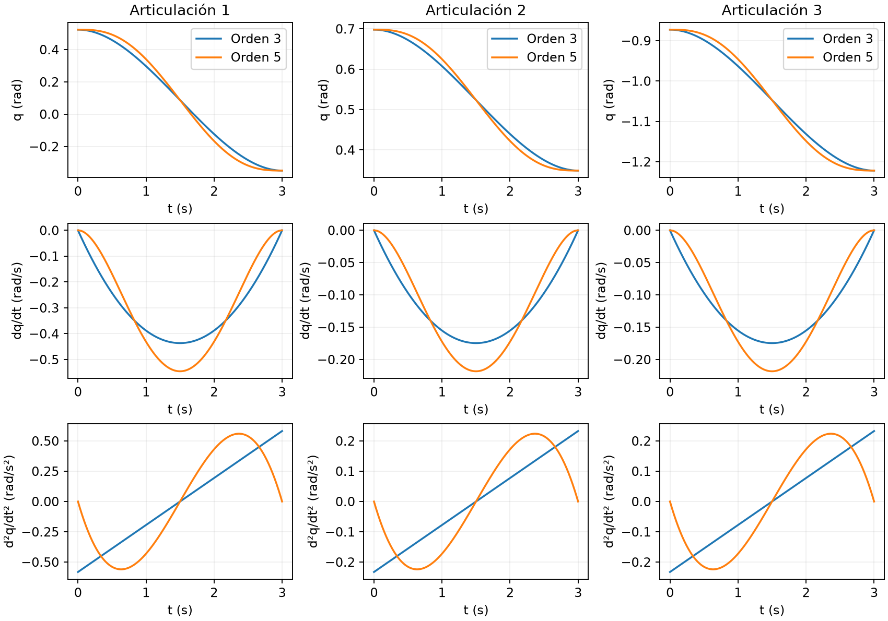
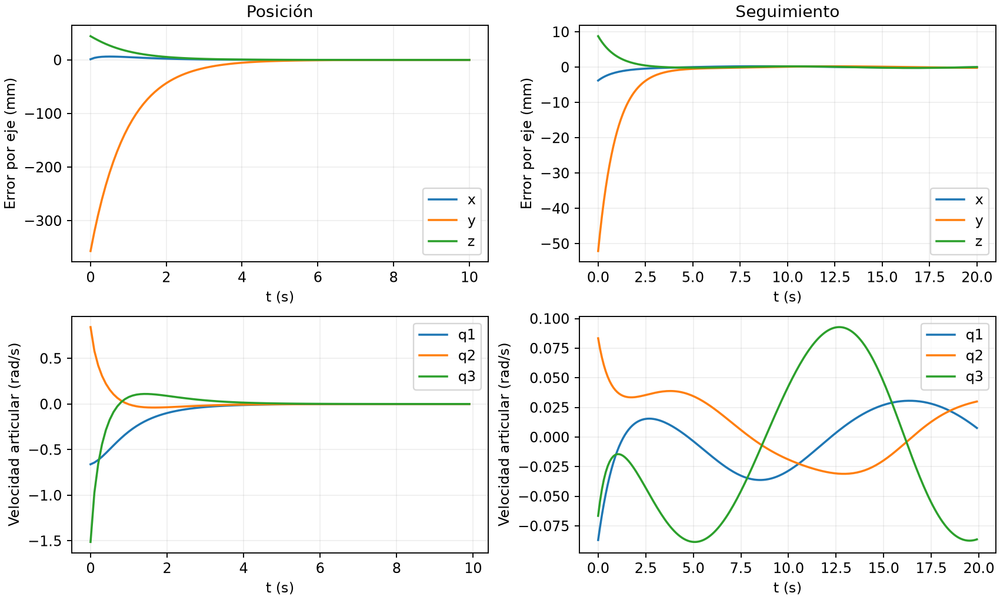
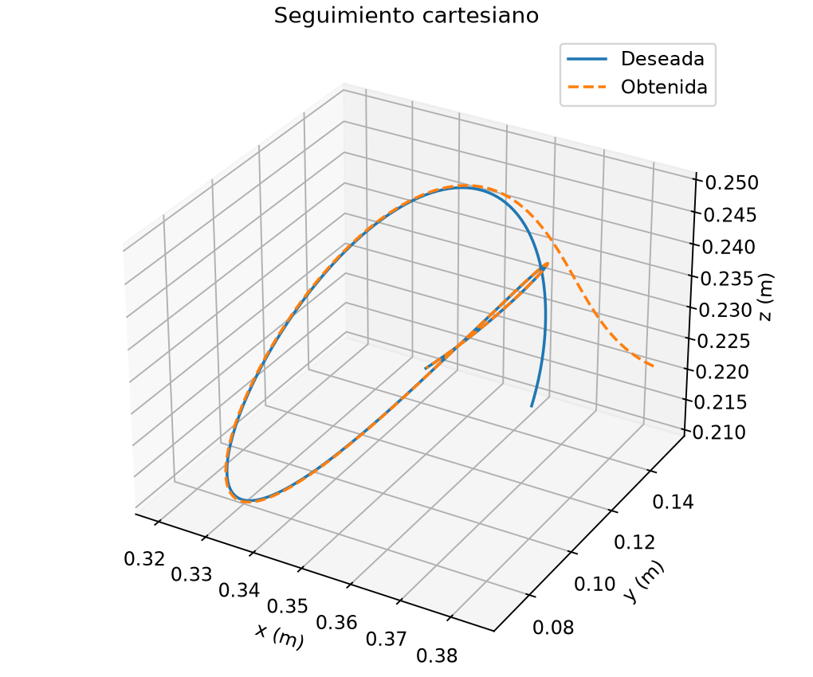

# Course results

Resultados ya ejecutados en [run-001](results/run-001/metrics.json), con parámetros en [config.json](config.json).

| Comprobación | Resultado |
|---|---|
| Directa geométrica frente a DH | Residuo 2.78e-17 m |
| Transformaciones elementales frente a DH | Diferencia máxima 8.33e-17 |
| Inversa, dos ramas de codo | Residuo máximo 1.50e-16 m |
| Espacio de trabajo | 9261 muestras; rangos ilustrativos del curso |
| Cúbica y quíntica | Velocidad nula en extremos; sólo la quíntica impone también aceleración nula |
| Control de posición | Error final 9.57e-6 m en 10 s |
| Seguimiento | RMSE entre 10–20 s: 2.67e-4 m; con paso mitad: 1.33e-4 m |
| Inicio singular y objetivo radial | Error de 0.03 m sin reducción; limitación de la pseudoinversa |

Las cifras describen simulación cinemática ideal sin saturación ni dinámica. Los objetivos, ganancias, duración y malla temporal están declarados; no son resultados experimentales del paper.

Para repetir los cálculos de forma opcional: `uv run python run.py course --run-id run-002`. Una ejecución nueva requiere un identificador distinto. Las tablas CSV, métricas y hashes quedan junto a sus figuras.
