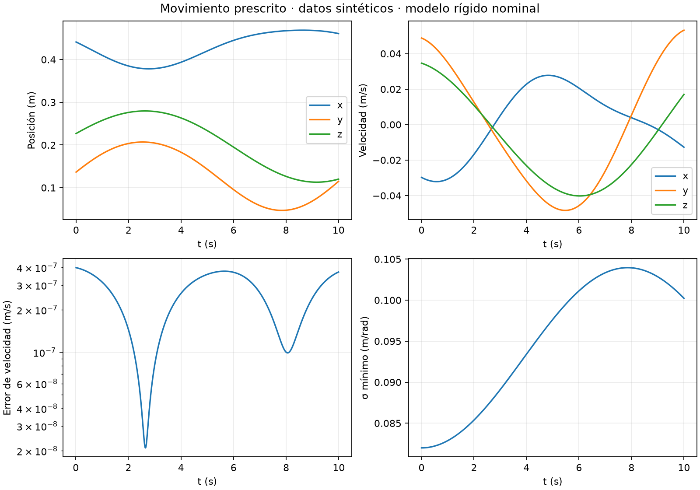
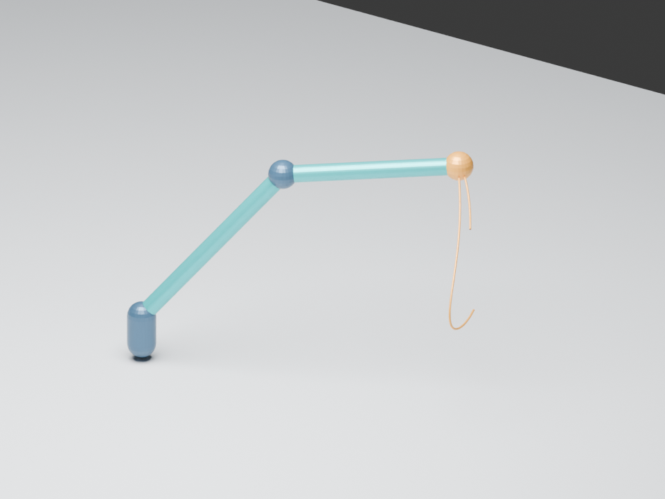

# EXP-001 · Differential velocity consistency

## Pregunta y protocolo

¿Coincide Jv(q) qdot con la derivada numérica de la posición y converge el error al refinar el paso? Se prescribe un movimiento suave, sin control cerrado:

- q1=0.3+0.2 sin(0.6t), q2=0.7+0.15 sin(0.5t), q3=-0.8+0.1 cos(0.4t).
- Derivadas analíticas de q para calcular v.
- Intervalo 0-10 s; pasos 0.02, 0.01 y 0.005 s.
- Derivadas centrales de p, excluyendo extremos.
- Criterio: error máximo menor que 1e-5 m/s en los tres pasos.
- Presupuesto: una ejecución determinista, hasta 2001 muestras por paso; sin servicios externos. Detener ante error de validación.

La [configuración](config.json) fija longitudes y tolerancia. Los rangos no representan límites físicos.

## Ejecución inicial en Review

[Manifiesto run-001](results/run-001/manifest.json), [trayectoria](results/run-001/trajectory.csv) y [poses para Blender](results/run-001/motion.json).

El error máximo con dt=0.01 s es aproximadamente 3.99e-7 m/s y se reduce por un factor próximo a cuatro al dividir el paso por dos. El sigma mínimo muestreado es aproximadamente 0.08199 m/rad. La evidencia respalda consistencia nominal, no exactitud física.

`uv run python run.py simulate --run-id run-002` genera una ejecución nueva; no sobreescribe run-001. El [visor HTML preparado](results/run-001/robot-motion.html) se descarga y se abre en un navegador; GitHub muestra su código fuente. La [escena Blender](results/run-001/blender/vsl-3dof-study.blend) también se incluye lista para abrir.

