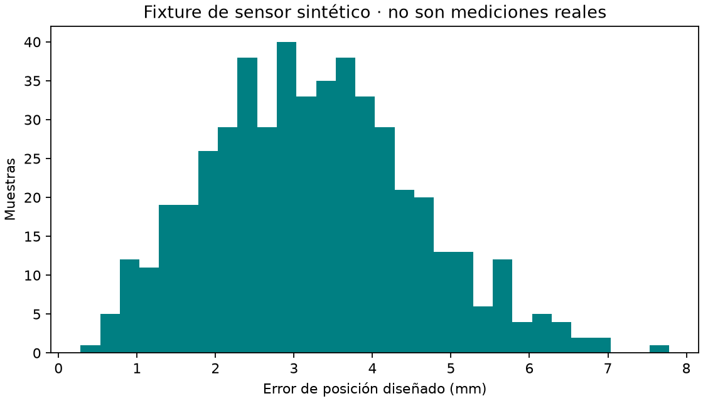

# EXP-002 · Synthetic sensor fixture

## Propósito

Probar el flujo de datos, métricas y gráficos mientras no se disponga de mediciones. **Todos los datos son sintéticos.** No son datos del artículo ni del prototipo físico.

## Protocolo

500 configuraciones uniformes en [-1,1] rad por articulación; posición verdadera definida por el modelo nominal; observación dummy igual a esa posición más ruido gaussiano independiente de desviación estándar 0.002 m por eje. Semilla 2026.

Se calcula RMSE de la norma cartesiana. Su escala esperada es sqrt(3)×0.002≈0.003464 m. Criterio de prueba del fixture: RMSE entre el 85% y 115% de esa escala. Es un control del generador, no un umbral de precisión del robot. Presupuesto: 500 muestras, sin ajustes, servicios externos ni selección de la semilla según el resultado.

## Resultado inicial en Review

[Configuración](config.json), [datos](results/run-001/synthetic-sensor.csv) y [manifiesto](results/run-001/manifest.json). RMSE observado ≈0.003505 m.

El ruido gaussiano es una hipótesis de fixture. No representa calibración, sensores específicos, presión, flexibilidad ni distribución medida. Cualquier futuro conjunto real requiere procedencia y protocolo separados.

Ejecución opcional: `uv run python run.py dummy --run-id run-002`.
